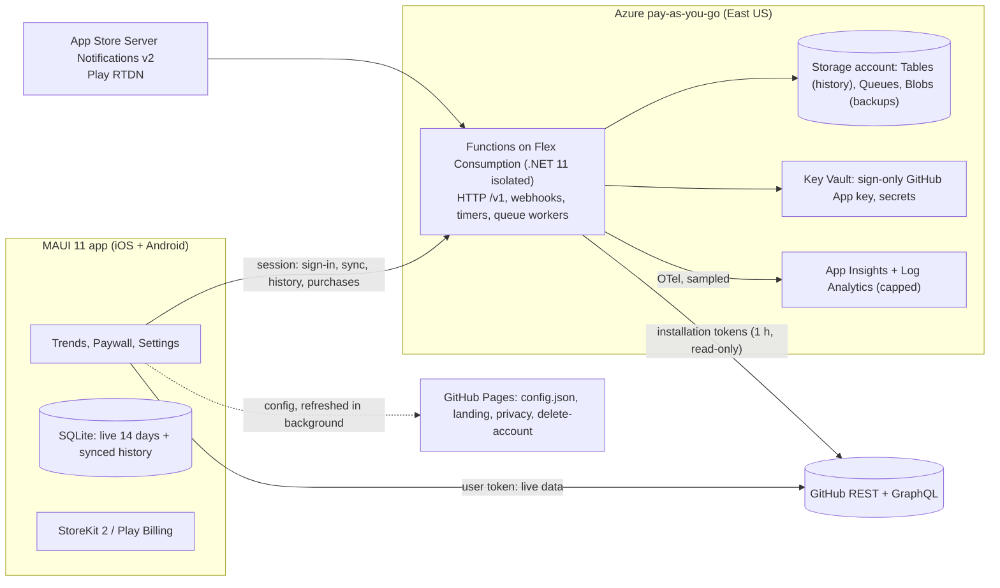

# GitTrends relaunch plan (.NET 11, Premium, Aspire + OpenTelemetry)

**Status:** plan only. Nothing here has been implemented. Written 2026-11-15.

**Appendices** (same folder):

| File | What it holds |
|---|---|
| [architecture.md](architecture.md) | Full target design: components, auth, collector, data model, API, Aspire, Azure resources, purchases, telemetry, privacy, CI/CD |
| [estimates.md](estimates.md) | Effort, calendar and token estimates. Two independent methods, reconciled |
| [forecast.md](forecast.md) | 3-year revenue vs cost model with bear, base and bull cases, break-even, and pricing comparison |
| [fact-check.md](fact-check.md) | Facts that were checked against primary sources, and the corrections that changed the plan |
| [model/forecast_model.py](model/forecast_model.py) | The forecast model. Change the prices or assumptions and re-run it |

Phase 0 security actions that relate to the old, still-installed app builds are **not in this public repo**. The owner has them privately.

---

## 0. Answers in one page

| Question | Answer |
|---|---|
| **What are our gaps?** | Seven groups, listed in §2: 1. Accounts and hardware only you have. 2. An app that doesn't build on .NET 11 and can't start without its backend. 3. No backend at all. 4. No Premium plumbing. 5. No operations or compliance setup. 6. Claude's cloud container can't build .NET or Android yet. 7. Business data we don't have. |
| **How long would it take Claude?** | **About 310 Claude agent-hours** (range 235–415). **About 160 of your hands-on hours** (range 130–210). Your hours set the calendar, not Claude's: • **At 15 h/week:** free 3.0 in stores around week 10 (late Jan 2027); Premium 3.1 around week 15 (early–mid Mar 2027). • **At 5 h/week:** around week 20 (Apr 2027) and week 32 (late Jun–Jul 2027). Done by a human alone, the same work is about 525–1,030 engineer-hours. |
| **Weekly token usage % on Claude Ultra?** | Anthropic doesn't publish Ultra's weekly limit in tokens, so I can't turn tokens into a % from published numbers. Instead, use this planning session as the yardstick: it processed **about 163M tokens** (about $85–100 at API rates). Weekly usage compared with this session: • **Peak build weeks:** about **0.7–1.1×** this session. • **Typical build weeks:** about **0.45–0.6×**. • **Weeks after launch:** about **0.05–0.1×**. **Open `/usage` now.** If this session used *P*% of your week, budget about *P*% for peak weeks and *P*/2 for typical ones. §9 has a lookup table. |
| **Revenue vs cost?** | **Costs:** $137–161 a year at 500–2,000 monthly users. Apple's $99 fee is the biggest line; Azure production is only $15–42 a year. **3-year net revenue:** bear $267, base $1,735, bull $11,587. **3-year profit:** **−$156, +$1,289, +$10,824**. Subtract $800 more if you count four months of Ultra as a build cost. **Break-even:** about 5 annual subscribers. |
| **$10/mo and $100/yr?** | **Keep those prices, but for a later Pro tier.** Launch **Premium at $4.99/mo or $39.99/yr**: 14-day trial on annual, and a $19.99 first year for Founding Members. A $9.99/$99.99-only tier earns about the same over 3 years at base (about 10% less) and more in year 1, with about 2.6× fewer paying users. At this scale price barely matters; user growth does. |
| **Store everyone's data?** | **Yes. Collect for every user who installs the GitHub App** (with disclosure and an opt-out). It costs about **$0.001–0.005 per user per month**. • **Free users:** the last 12 months are banked quietly, shown as "N days saved". • **Premium:** unlocks that history instantly and keeps it **forever while subscribed**, plus 12 months after a lapse. • **No "forever" tier:** forever costs under $0.05 a month per extra year, so it isn't worth a tier. |
| **Aspire + OpenTelemetry?** | **Aspire covers local development, telemetry wiring and CI tests:** • the AppHost runs Azurite, Functions, a GitHub mock and a dev tunnel; • ServiceDefaults set up OTel, resilience and health checks; • `Aspire.Hosting.Testing` runs in CI; • OTel runs end to end into Application Insights. **Production is deployed with Bicep and GitHub Actions to Functions Flex Consumption, not `aspire deploy`:** • `aspire deploy` targets Container Apps and requires Azure Container Registry. Basic is about $5/mo, more than the whole backend at 500 users. • .NET 11 Functions container images are broken today. If an Aspire-deploy showcase matters to you, it costs about $5–11/mo once Microsoft fixes the image. That is one of your decisions (§12). |
| **MVP Azure credit?** | Use it for **staging, load tests and spikes only.** The Visual Studio Enterprise credit terms forbid production. It also doesn't cover Application Insights, and the Functions free grant doesn't apply on it. **Production runs on pay-as-you-go**, which costs about $1–4 a month at our scale. |

---

## 1. Where things stand

**Why the app died.**
- **Startup depended on the backend.** Whenever its cache was empty (every fresh install), the app waited on backend calls during startup and showed "Initialization Failed" when they failed. The statistics call blocked in every build.
- **Then the 2024 retirements hit:** Xamarin end of support, legacy FCM, Azure Media Services, and .NET 7 on Functions.
- **The MAUI rewrite deleted four endpoints** the shipped 2.5.11 client still called.
- **Nothing alerted.** There was no monitoring.

**What the old backend did.** It never stored user data. Only the GitHub OAuth code exchange really needed a server. Everything else can move into the app or the build:
- Client ID and config: a build constant plus `config.json` on GitHub Pages.
- Library list: generated at build time.
- Repo stats: fetched by the client.
- Syncfusion key: replaced by the free, MIT-licensed `Syncfusion.Maui.Toolkit`.

**Where the code is.**
- This fork's `master` is the v0.9.0 snapshot from February 2020.
- The latest code is upstream `main` (Nov 2025): MAUI on .NET 9, never shipped. It is 2,077 commits ahead and 0 behind, so `master` can be fast-forwarded with no conflicts.
- Which repo is canonical is your decision (§12).

**Since 2020, GitHub changed things the plan uses:**
- Traffic data is still kept for only 14 days.
- Stargazer listing was restricted in July 2026.
- New `/stargazers/count` and `/stargazers/history` endpoints exist.
- GitHub Apps now support PKCE.
- Installation tokens have a new format.

---

## 2. Gaps

### A. Only you can close these

| Gap | Why it matters |
|---|---|
| Phase 0 security actions (sent privately) | They protect people who still have old builds installed. **Do these this week** |
| A Mac on macOS 26.6+ with Xcode 27.2, plus one iPhone and one Android phone | iOS signing, device QA, UIScene checks and store screenshots. Claude has no Xcode and no Android emulator |
| Access to App Store Connect, Play Console, signing certificates and the Play upload key (or Play App Signing) | Without them we can't ship to the same listings |
| Apple Small Business Program enrollment | Cuts Apple's commission from 30% to 15% |
| Production Azure subscription (pay-as-you-go) with a $25 budget | The MVP credit can't host production |
| GitHub org ownership of three GitHub Apps (Dev, Staging, Prod) | Replaces the OAuth App and its write-scoped `public_repo` |
| A domain (for `api.<domain>` and the GitHub Pages site) | Custom API hostname, privacy policy and landing page |
| Legal posture | Privacy policy, collecting for free users before they subscribe (especially in the EEA), and GitHub's terms on paid apps (AUP §6) |

### B. App: it doesn't build on .NET 11 and won't start without a backend

| Gap | Fix |
|---|---|
| .NET 9 MAUI; Compatibility package; Mono-only settings | Retarget to .NET 11 / MAUI 11, which runs on CoreCLR only. Remove the Compatibility package |
| No `UIApplicationSceneManifest`, so .NET 11 iOS builds fail with **MT7199** | Add a SceneDelegate and the manifest |
| 47 calls to APIs obsoleted in .NET 10 (CS0618 is an error) | Rename to `DisplayAlertAsync`, `FadeToAsync` and so on |
| Startup waits on the backend | Compiled defaults, background refresh of `config.json`, and no network call on the startup path |
| `AppStore` build config is broken. The SDK defines `APPSTORE`, so the `#if AppStore` code never compiles; the Sentry DSN is null, so the app likely crashes at launch; Android is debuggable | Fix the config, and add a CI job that builds `-c AppStore` and checks the output |
| Android `ApplicationId` is `com.minnick.GitTrends`, but the Play listing is `com.minnick.gittrends` | Use lowercase to keep the existing listing |
| Packages: Syncfusion (paid key), Sharpnado, Shiny 3 (to 6, no migration notes), Plugin.StoreReview, a 758-line Shell renderer that reflects into a private field | Move to Syncfusion Toolkit (MIT), Border and Shadow, and Shiny 6 (or native jobs), and simplify the renderer |
| OAuth App with `public_repo` (a write scope); the client secret goes in a query string; no PKCE; the app logs users out when the scope lacks "org" | Switch to a read-only GitHub App with PKCE, exchange the code on the server, and remove the org check |
| Data stops at GitHub's 14 days, and the local database has duplicate rows and unbounded stargazer rows | Add a synced history store, key rows on `databaseId`, and fix the local schema |
| 79 of 397 test cases (77 of 186 test methods) depend on the dead backend; UI tests use the dead Xamarin.UITest | Rework 80–100 tests against mocks and delete the UI tests |
| `AnalyticsService.Track` is a no-op at 56 call sites; Sentry samples 100% of traces | Send anonymous events batched on the sync call, and sample Sentry at 5% |
| Malformed `PrivacyInfo.xcprivacy`; `GitTrends.Shared` duplicates Common and is unused | Fix the manifest and delete the dead project |

### C. Backend: none exists

Every Azure resource was deleted, and the 2020-era Functions code is obsolete. Release 3.0 needs:
- auth exchange and sessions;
- GitHub webhooks;
- a history collector for every installation;
- reconciliation;
- backups;
- health checks;
- OTel;
- Bicep;
- CI/CD.

All of it is new code on .NET 11 isolated Functions.

### D. Premium: nothing exists

| Area | Needed |
|---|---|
| Store products and integration | Subscription products, StoreKit 2 and Play Billing in the app |
| Server verification | App Store Server API and Notifications V2; Play RTDN and `subscriptionsv2` |
| Accounts and access | Binding a purchase to a GitHub account, entitlement state, gating at read time |
| App UI | Paywall, Restore Purchases, the guideline 3.1.2 disclosures, history UI, CSV export, demo mode for App Review |
| Store paperwork | Apple paid-apps agreement plus banking and tax; Play payments profile |

### E. Operations and compliance

| Area | Needed |
|---|---|
| Monitoring | None today. Add a collector heartbeat, `/health` probes and budget alerts |
| Data protection | Table Storage has no point-in-time restore, so add exports and resource locks |
| Account deletion | Required by both stores: an in-app path plus a web deletion page |
| Privacy | Rewrite the privacy policy, App Store privacy labels and the Play Data safety form |
| CI/CD | Azure DevOps with keys injected by `sed` and no deploy step. Move to GitHub Actions with OIDC |

### F. Claude's build environment

The cloud container has **no .NET SDK**. Its network proxy blocks the .NET and Android SDK download hosts, and it has no KVM, so no Android emulator.

When implementation starts, I'll ask you once to allow those hosts in this environment. iOS compile loops run on free macOS GitHub Actions runners, since the repo is public. Visual checks happen on your devices.

### G. Data we don't have

- Historical monthly users, iOS/Android split, and repos per user. These calibrate the forecast.
- Last build numbers uploaded to each store.
- Play account standing.
- Whether GitHub returns private-repo traffic for repos owned by GitHub Free accounts.

§13 lists everything to pull.

---

## 3. Recommended architecture

Three architect proposals were scored by a judge: frugal, trust-first and growth-first. The winner is the frugal base, with the growth plan's phased launch and the trust plan's security model grafted in. Details are in [architecture.md](architecture.md).

**The rules that keep it cheap and resilient:**
1. **The app never needs Azure to start or to show live data.** Views, clones, referrers, paths and stars come straight from GitHub using the user's own read-only token. If Azure is down, only sign-in, banked history and purchase checks wait.
2. **One read-only GitHub App** (Administration: read and Metadata: read) replaces the write-scoped OAuth App.
   - Sign-in uses PKCE; the code exchange runs on the server, because GitHub still requires the client secret.
   - User tokens don't expire. Otherwise the backend would be back on the live-data path every 8 hours, which is the 2024 failure again.
3. **The server collects traffic for every installation** using installation tokens, so no user needs to be online.
   - It runs daily for everyone until Premium ships, then daily for paid users and weekly for free ones.
   - Weekly still loses nothing, because GitHub keeps 14 days.
4. **No database.** Table Storage holds about 60 bytes per repo per day, stored only against numeric IDs. Repo names, logins, emails and tokens are never stored.
5. **Functions Flex Consumption with always-ready set to 0.** It bills per execution, and the free grant covers us up to about 2,000 users.
6. **Purchases go directly to Apple and Google.** RevenueCat sits behind an interface as a fallback only.
7. **OpenTelemetry everywhere, kept cheap.**
   - Metrics over spans for GitHub calls.
   - 5–10% trace sampling.
   - URLs templated, so private repo names never reach telemetry.
   - A 0.15 GB/day cap on Log Analytics.
   - Sentry (free plan) on mobile at 5%.

**Where Aspire fits** (Aspire 13.6.5):
- **AppHost.** Runs Azurite (tables, queues, blobs), the Functions project, a GitHub mock that replays canned traffic and injects rate limits, and a dev tunnel for webhooks and physical phones. Optionally, preview `Aspire.Hosting.Maui` shows mobile traces in the dashboard.
- **ServiceDefaults.** OTel, resilience handlers on the GitHub clients, health checks and redaction.
- **Aspire.Hosting.Testing.** Integration tests in CI spin up the whole stack on an Ubuntu runner.
- **Production.** Bicep plus GitHub Actions OIDC deploy a code package to Flex. There is no container registry.

---

## 4. Storage, retention and tiers

| Who | What's collected | What they see | Kept |
|---|---|---|---|
| Free | Daily until 3.1, then weekly. Lossless for views and clones | Live 14 days, plus a teaser: "N days saved" | Rolling 12 months |
| Premium | Daily, plus daily referrer and path snapshots | All banked history, from 14 days to All | **Forever while subscribed**, plus 12 months after a lapse |
| App uninstalled or account deleted | Collection stops | n/a | Purged after 30 days (uninstall) or within 24 hours (deletion). Backups age out within 40 days |

**Why collect for everyone.**
- **It's nearly free.** Lean storage at 500 users is 2–11 GB a year, about $0.09–0.51 a month.
- **It is the best conversion lever.** When someone subscribes, a year of their history appears at once. Collecting only for subscribers cuts 3-year base profit from $1,289 to $701.
- **It's how users discover the value.** A day-15 local notification says "GitHub just deleted your oldest traffic day. GitTrends saved it."

**Why no "forever" tier.**
- Keeping paid repos forever in Cold blob storage costs under $0.01 a month per extra year at up to 2,000 users.
- Charging extra for forever would feel petty and add complexity.
- The $9.99/$99.99 price point survives as **Pro**, sold on features that cost real money: server push alerts, widgets, a web dashboard, multiple accounts.

---

## 5. Pricing (starting from your $10 and $100)

| Tier | Monthly | Annual | Notes |
|---|---|---|---|
| Free | $0 | $0 | Live data, popular paths (new), stars, private and org repos through the App, local trending alerts, history banked quietly |
| **Premium** | **$4.99** | **$39.99** | 14-day trial on annual. **Founding Member: $19.99 for year 1**, then the price is locked. History UI, referrer and path history, CSV export, cross-device |
| Pro (later, once demand shows) | $9.99 | $99.99 | Spike push alerts, widgets, web dashboard, multiple accounts, scheduled exports |

**Why not $9.99/$99.99 as the only tier:**
- **It's high for the market.** $99.99/yr is about 2.5× the North American median for mobile annual plans ($39.99), above Repohistory ($90/yr, or free for 1 repo, and self-hostable), and about 8× RepoEasy (€12/yr).
- **Freemium conversion is low:** about 2% on iOS and under 1% on Android.
- **Parity is close to the assumed rate.** The single tier earns more over 3 years only if it converts at **55% or more** of the ladder's rate (49–57% across scenarios). The assumed rate is 50%, so the ladder ends about 10% ahead with 2.6× more paying users.
- **The single tier wins year 1** ($284 vs $227 net).
- **The stakes are small** either way: under $200 over 3 years at base.

If you want to test price-insensitivity, test $99.99 as Pro, not as the only tier.

---

## 6. Cloud cost and the savings measures

**Production, monthly, with 1-year retention:**

| Line | 500 users | 2,000 users | 10,000 users |
|---|---|---|---|
| Functions Flex compute (after the free grant) | $0 | $0–0.50 | $2–10 |
| Table Storage history | $0.09–0.51 | $0.36–2.05 | $1.80–10.30 |
| Blob backups, queues, transactions | $0.05–0.30 | $0.10–0.60 | $0.50–2 |
| Key Vault, metric alerts, egress | $0.20–0.35 | about $0.35 | $0.50–1.60 |
| Log Analytics / App Insights (capped) | $0 | $0 | $0–7 |
| **Total** | **$0.40–1.50** | **$0.80–3.50** | **$5–31** |
| For comparison: Container Apps via `aspire deploy` | $5–11 | $10–20 | $18–40 |

**Not in the table:**
- Apple Developer Program, $99/yr: the single largest cost.
- Domain, about $20/yr.
- Staging, about $2–10/mo, paid by the MVP credit.

**Savings built into the design:**

| Measure | Saves |
|---|---|
| No database: Table Storage instead of Postgres or SQL | About $16+/mo |
| Code deploy to Flex, so no container registry | About $5/mo (ACR Basic) |
| Always-ready instances set to 0; the free grant covers 500–2,000 users | The whole compute bill at our scale |
| App sync batched to at most once per foreground and every 6 hours | Keeps Flex executions inside the free grant |
| No Notification Hubs: local notifications in v1, direct APNs and FCM later | $10/mo (Basic) |
| Log Analytics capped at 0.15 GB/day, 30-day retention, metrics-first, sampled | Stays inside the 5 GB/mo free allowance |
| Public repo, so free GitHub Actions minutes, including macOS | About $31–60/mo |
| GitHub Pages for landing, policies and `config.json`; DNS at the registrar | $0 instead of an App Service or Azure DNS |
| Syncfusion Toolkit (MIT) instead of licensed Syncfusion | License cost and key handling |
| Sentry free plan at 5% traces, no replay | $26–29/mo until about 4,000 users |
| Startup that doesn't depend on the backend | No need for high availability, multiple regions or on-call |
| Collect free users weekly after 3.1, and back off dormant repos to every 13 days | Weekly loses nothing (GitHub keeps 14 days). The dormant back-off alone cuts GitHub calls by about 35% at 10,000 users |
| Cold blob archive for older paid history (once Table passes about 50 GB) | Storage at $0.0036/GB instead of $0.045/GB |
| MVP credit pays for staging and load tests | About $24–120/yr |

**Things to avoid** (fixed fees, not Azure, are what turn this unprofitable):
- private-repo CI;
- Sentry Team from day 1;
- paid staging;
- an EU representative before revenue justifies it.

Together these turn the 3-year base case from +$1,289 into −$1,975.

---

## 7. Environments and the MVP credit

| Environment | Subscription | Purpose | GitHub App |
|---|---|---|---|
| Local | none | Aspire AppHost, Azurite, GitHub mock, dev tunnel, dashboard | GitTrends (Dev) |
| Staging | **MVP Visual Studio Enterprise credit** ($150/mo, spending limit on) | TestFlight and Play internal builds, store sandbox notifications, 10k-user load tests, cost spikes | GitTrends (Staging) |
| Production | **Pay-as-you-go** ($25 budget with alerts, resource locks) | Everything users touch | GitTrends |

**Credit facts, verified against Microsoft's terms:**
- The benefit is the $150/month Visual Studio Enterprise credit, which renews only while you hold the MVP award.
- It is dev/test only. Microsoft can suspend instances that run more than 120 hours or that it finds in production.
- It doesn't cover Application Insights, so staging telemetry is billed to the pay-as-you-go subscription at a 0.03 GB/day cap.
- The Functions free grant doesn't apply on it.
- I found no evidence of an MVP Azure sponsorship that allows production use. Check the MVP portal; if one exists, it can pay the small production bill.

---

## 8. Roadmap and effort

Estimates are reconciled from a bottom-up estimate (about 95 work items) and a top-down estimate (analogies, including this repo's own Xamarin-to-MAUI port). Details are in [estimates.md](estimates.md).

| Phase | Delivers | Claude agent-h | Your hours | Weeks at 15 h/wk | Weeks at 5 h/wk |
|---|---|---|---|---|---|
| **0. Stabilize and secure** | Private security actions, accounts, three GitHub Apps, subscriptions, domain, store checks, Mac toolchain, day-1 spikes | about 13 | about 13 | 1 | 1–3 |
| **1. App platform port** | .NET 11 / MAUI 11 green on iOS and Android, packages replaced, store-valid build configs, tests decoupled, CI building signed TestFlight and Play-internal builds | about 55 | about 25 | 2–7 (alongside 2) | 3–14 |
| **2. Backend** | Aspire AppHost, Functions on Flex, GitHub App auth and sessions, collector, webhooks, backups, OTel, Bicep, OIDC CI/CD. **Prod goes live and history banking starts** | about 75 | about 20 | 2–7 (alongside 1) | 3–14 |
| **3. Release 3.0, free relaunch** | Startup independence, GitHub App sign-in and install flow, popular paths, star endpoints, consent and teaser, account deletion, privacy paperwork, beta, App Review | about 50 | about 33 | 7–10 → **3.0 live around week 10** | 13–21 → **around week 20** |
| **4. Release 3.1, Premium** | Purchases on both stores, server verification, entitlements, history UI, CSV, Founding Member offer, demo mode, free users moved to weekly collection | about 90 | about 46 | 9–15 → **3.1 live around week 15** | 20–32 → **around week 32** |
| **5. Post-launch operations** (12 weeks) | Hotfixes, collector care, dependency updates, restore drill, forecast recalibration, HTTPS OAuth callback | about 33 | about 23 | 15–27 | 32–45 |
| **Total** | | **about 310** (235–415) | **about 160** (130–210) | | |

**Notes:**
- **Start date.** Weeks count from Monday 2026-11-16. The holidays probably add a week.
- **Pro is extra.** Not included above: about 50–75 Claude hours and 20–30 of your hours, 6–10 weeks, and only if demand shows.
- **The calendar is set by you.** It depends on your hours, device QA, and App Review. Claude's throughput only limits the schedule in weeks 2–7 at 15 h/week, if Ultra's weekly limit runs out.
- **Banking starts before 3.0 ships.** The production collector goes live at the end of Phase 2, so Premium launches with 30+ days of history already saved.
- **Biggest schedule risk: a repeat of the last port.** It reached code-complete but never shipped. Mitigations: strict scope (no Pro, no UI-test port), a store checklist started in Phase 0, and 3.0 shipped before any Premium work blocks it.

**Day-1 spikes, before committing to the plan:**
1. `Azure.Functions.Sdk` 1.1.0 (shipped 2026-11-14) running under Aspire's `AddAzureFunctionsProject`, plus a Flex code deploy. Fallback: a net10 backend with the same end of support (2028-11-14).
2. A MAUI 11 smoke build with Plugin.InAppBilling 11.0.1, Syncfusion Toolkit 1.0.12 and Shiny 6, all of which ship net10 builds only.

---

## 9. Claude Ultra weekly usage

**What's published:**
- Ultra is $200/month for "10x Pro usage" per week. Verified accounts have no 5-hour limit, so the weekly cap is the only one that matters.
- Claude.ai, Claude Code, cloud sessions and subagents all draw from the same weekly pool.
- **No token, hour or message figures are published** for any plan.

So the honest answer is a token forecast plus a 30-second calibration.

**Measured anchor.** This planning session (main thread plus 20 research, verification, design and estimation agents):
- 163M tokens processed: 157M cache reads, 4.9M cache writes, 1.4M output.
- About $85–100 at API rates.

**Forecast tokens per week (central values):**

| Period | At 15 h/week | Compared with this session | At 5 h/week | Compared with this session |
|---|---|---|---|---|
| Weeks 1–2 (Phase 0, spikes) | 15–70M | 0.1–0.4× | 15–50M | 0.1–0.3× |
| **Weeks 2–7 (port and backend in parallel, peak)** | **110–175M** (heaviest week up to about 250M) | **0.7–1.1×** (up to 1.5×) | 50–120M | 0.3–0.7× |
| 3.0 store weeks and Premium build | 75–110M | 0.45–0.7× | 25–50M | 0.15–0.3× |
| After launch | 5–15M | 0.03–0.1× | 5–15M | 0.03–0.1× |
| **Whole project** | **about 1.3B** (0.8–2.5B) | about 8× | same total, spread over 32+ weeks | |

**Lookup.** Run `/usage` (or open Settings > Usage) now and read what share of your week this session used. Check that your weekly reset didn't happen during the session. Then:

| This session used | Peak weeks at 15 h/wk | Typical build weeks | Fits Ultra? |
|---|---|---|---|
| 10% | 7–11% (up to 15%) | 5–6% | Easily. Max (5×) might do |
| 20% | 14–22% (up to 30%) | 9–12% | Easily |
| 35% | 25–39% (up to 53%) | 16–21% | Yes |
| 50% | 35–55% (up to 75%) | 23–30% | Yes. Watch peak weeks |
| 75% | 53–83% (up to 110%) | 34–45% | Peak weeks need sequencing, or usage credits at about $3–5 per agent-hour |

**Cost comparison.** The whole project is roughly $0.8k–1.4k at API rates, using this session's measured mix of about $0.60 per million tokens, or up to about $1.9k using the estimators' more conservative mix. Ultra for a 4-month build is $800.

**Keeping weekly usage down during implementation.** This planning session ran large multi-agent workflows, which are token-heavy by design. Implementation can use single sessions for most work and keep multi-agent review for the risky pieces: auth, purchases and the collector.

---

## 10. Revenue vs cost (3 years, December 2026 to November 2029)

Model: monthly cohorts with expected-value subscribers.
- Store fee 15% (Apple Small Business Program; Play 10% plus 5%).
- About 6% VAT drag outside the US, and 3% refunds.
- 3.0 launches in February 2027 and Premium in April 2027, about a month behind the 15 h/week calendar. Launching on time changes 3-year profit by only +$28.
- Your build hours aren't costed.

Details and sensitivities are in [forecast.md](forecast.md); the model is in [model/forecast_model.py](model/forecast_model.py).

| | Bear | Base | Bull |
|---|---|---|---|
| Monthly users at end of Y1 / Y2 / Y3 | 300 / 375 / 400 | 600 / 900 / 1,200 | 1,500 / 3,000 / 5,000 |
| New payers a year (share of monthly users) | 1% | 2.5% | 5% |
| Paying subscribers at end of Y3 | 4 | 25 | 192 |
| Net revenue Y1 / Y2 / Y3 | $51 / $98 / $118 | $227 / $600 / $908 | $1,044 / $3,612 / $6,931 |
| Total cost Y1 / Y2 / Y3 | $155 / $133 / $134 | $159 / $141 / $146 | $167 / $175 / $421 |
| **Profit Y1 / Y2 / Y3** | −$104 / −$35 / −$16 | +$68 / +$459 / +$762 | +$877 / +$3,437 / +$6,510 |
| **3-year profit** (after $800 of Ultra) | **−$156** (−$956) | **+$1,289** (+$489) | **+$10,824** (+$10,024) |
| Month 36: net revenue vs cost | $10 vs $1.30 a month | $86 vs $2.40 | $720 vs $43 |

**Break-even:**
- **Cash:** about 5 annual Premium subscribers at 500–2,000 users (about 1% of users). About 13 if they must also repay $800 of Ultra within 3 years.
- **Base timing:** cumulative running costs are covered by month 10 (September 2027), and the $800 is repaid by month 30.
- **Your time:** paying yourself $50/h for your roughly 160 hands-on hours is $8,000. Only the bull path (+$10,024 after Ultra) earns that back within 3 years; base earns about $3 per hour of your time.

**Reading it.**
- The downside is capped at about $150 over 3 years, plus your time.
- Most costs are Apple's fee and the domain, which a free-only relaunch would pay anyway.
- The upside depends almost entirely on **growing well past the 2020 audience**: landing page, community launch, your .NET and MVP reach.
- The biggest levers, in order:
  1. user growth;
  2. collecting history for everyone (about 2× profit);
  3. keeping fixed fees at $0;
  4. conversion.

  Price structure and cloud architecture barely matter at this scale.

**Decision gates:**
- **Month 6 (May 2027).** On track if: 300+ monthly users, 5+ payers, trial starts of 1.5%+ of users.
- **Month 12 (November 2027):**
  - **Bear signal** (under 400 users and under 5 payers): freeze feature work and keep running costs at about $11/month. The free app and history banking keep working.
  - **Bull signal** (over 1,500 users and over 3% paying): build Pro.

---

## 11. Top risks

| Risk | Mitigation |
|---|---|
| **New .NET 11 toolchain.** The Functions SDK is 1 day old; three key libraries ship net10 builds only | Day-1 spikes, with a net10 fallback (same end of support) |
| **Collector reliability is the product.** A silent outage longer than 13 days loses days for good | Heartbeat checked by a GitHub Actions cron every 30 minutes that opens an issue on failure, a self-healing scheduler, gap markers, and a poison-queue check |
| **Unrecoverable data loss.** Table Storage has no point-in-time restore, and the resources were all deleted once before | Weekly and monthly exports to Cool storage, CanNotDelete locks, data-plane RBAC only, re-collection of the last 13 days |
| **Consent friction.** Users see "Read access to administration"; org repos need an org owner to install | Plain-language explainer, a published endpoint allowlist, an "ask your org owner" share sheet, funnel metrics |
| **GitHub terms and platform changes.** AUP §6 wording; traffic retention or permission changes; private-repo traffic on Free accounts | Ask GitHub in writing before charging; sell features beyond retention; test private repos early |
| **In-house store integration.** Grace periods, account holds, refunds, account switching | One tier at launch, always re-query the store, sandbox testing on staging, RevenueCat as fallback |
| **Privacy.** Collecting before people subscribe, private-repo paths, missed uninstall webhooks | Disclosure at install plus an active choice in the app, daily reconcile, deletion within agreed times, counsel review (this is not legal advice) |
| **Solo-maintainer bandwidth.** The last port stalled before release | Phased releases with strict scope. No on-call, because the live app survives backend outages |

---

## 12. Decisions for you

1. **Pricing.** Approve Premium at $4.99/$39.99 with a 14-day annual trial and a $19.99 Founding Member year, with $9.99/$99.99 kept for Pro. The alternative is your $9.99/$99.99 as the only tier.
2. **Aspire in production.** Recommended: Aspire for local development, tests and telemetry, with Bicep deploying to Flex (about $1–4/mo). The alternative is `aspire deploy` to Container Apps as a showcase: about $5–11/mo more at 500 users, and blocked until the .NET 11 Functions image is fixed.
3. **Canonical repo and branch.** Fast-forward this fork's `master` to upstream `main` (2,077 commits, no conflicts) and rename it `main`, or develop in the upstream repo directly.
4. **Your weekly hours.** 5 h or 15 h per week sets the whole calendar (3.0 around week 10 vs week 20).
5. **Legal posture.** Confirm with counsel the "collect with disclosure plus opt-out" model, especially for EEA users. Decide on a business contact address, and whether to appoint an EU/UK representative later (about €100–300/yr).
6. **GitHub terms.** Email GitHub for written comfort on AUP §6 before charging (recommended), or launch without it.
7. **Ownership.** Which GitHub org owns the three GitHub Apps (the existing GitTrends org is the natural choice), and which domain to use.
8. **Legal entity (optional).** It unlocks Microsoft for Startups' $4,800 credit (otherwise $200 for 90 days). Not worth forming one for the credits alone.

---

## 13. Info to pull for me

**Urgent (this week):**
1. The private Phase 0 security checks I sent you, and what you find.
2. Whether your Apple Developer, App Store Connect and Play Console accounts are active, plus any warnings shown in Play Console.

**Before Phase 1:**

3. From App Store Connect:
   - the last version and build number uploaded, and the app's status;
   - historical downloads, active devices and sessions (App Analytics), for the forecast;
   - your Small Business Program status.
4. From Play Console:
   - the last `versionCode`;
   - whether Play App Signing is on, and whether you still have the upload key;
   - historical installs and active users;
   - confirmation that the package is `com.minnick.gittrends`.
5. Any other usage history you kept: old App Center or App Insights exports, Sentry stats. I want peak monthly users, the iOS/Android split and repos per user.
6. Hardware: your Mac's macOS and Xcode versions, and which test devices you have.
7. The MVP portal benefits page: whether your $150 Visual Studio credit is active, and whether any "Azure sponsorship" option is listed.
8. Whether you own a domain for GitTrends, and which one you want for `api.<domain>` and the site.
9. Your answers to the decisions in §12, especially pricing, repo, weekly hours and Aspire deploy.

**When implementation starts:**

10. Approve the one-time cloud-environment change for this session, so Claude can download the .NET 11 and Android SDKs.
11. Create the three GitHub Apps from the manifests I'll generate, then store their keys in Key Vault. Claude never sees the private keys.

---

## 14. Verify before building

1. `AddAzureFunctionsProject` works with `Azure.Functions.Sdk` 1.1.0, and Core Tools support .NET 11.
2. Plugin.InAppBilling 11.0.1 runs on MAUI 11 CoreCLR, and whether it sets `appAccountToken`. If not, the server sets it through the App Store Server API.
3. GitHub Apps can still opt out of user-token expiration.
4. Private-repo traffic is returned for repos owned by GitHub Free accounts.
5. Exact Aspire 13.6.5 API names: `AddQueues`, `WithExplicitStart`, `AddDevTunnel`.
6. East US prices for Table, Blob and Log Analytics, checked in the Azure pricing calculator. Some came from secondary sources.
7. Xcode 27.2 is available on GitHub-hosted `macos-26` runners.

---

### How this plan was made

The plan came out of two multi-agent runs:
- **Discovery.** 8 agents inventoried the backend, the app's data flow, the build upgrade surface and the git history, and researched .NET 11, Aspire, OTel, Azure and GitHub costs, store economics and Claude plans.
- **Design.** 5 skeptical verifiers checked the key facts against primary sources. 3 architects proposed designs that a judge scored and merged. Two independent estimators and a financial modeller produced the numbers.

Every correction the verifiers found was applied (see [fact-check.md](fact-check.md)). Figures marked as ranges are honest uncertainty, not padding.
