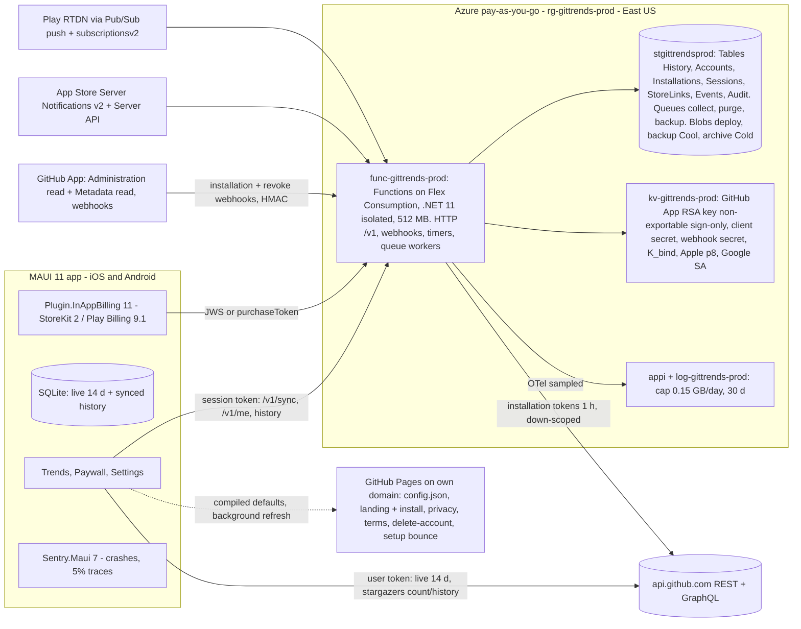
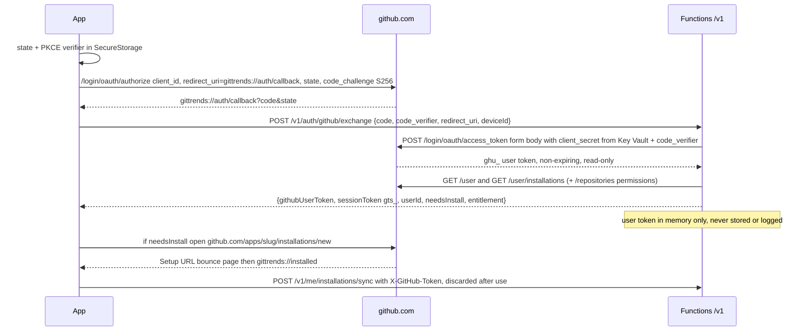

# GitTrends relaunch: target architecture

Part of the [relaunch plan](README.md). This is the design the judge picked after scoring three architect proposals: frugal, trust-first and growth-first. Every verifier correction is applied ([fact-check.md](fact-check.md)). Sections marked "check on day 1" depend on toolchains that shipped this week.

**Base:** arch-frugal: Functions on Flex Consumption, Table Storage, Aspire for local development only, and direct store integration.

**Taken from arch-growth:**
- A phased launch: free 3.0 starts banking history, and Premium 3.1 launches with that history already in place.
- Daily collection for everyone while the user base is small.
- A Founding Member offer.
- Personal teasers and a day-15 local notification.
- An install page on the landing site.
- Product events carried on the sync call.
- Gaps shown honestly, plus a win-back window after a lapse.

**Taken from arch-trust:**
- Phase-0 cleanup.
- Only numeric IDs stored on the server.
- A sign-only GitHub App key in Key Vault.
- HMAC-derived purchase binding.
- Redaction and URL templating in telemetry.
- An egress allowlist.
- Webhook redelivery.
- Down-scoped installation tokens.

All verifier corrections are applied.

## 0. Summary

| Area | Decision |
|---|---|
| Compute | One **.NET 11 isolated Azure Functions** app: `Azure.Functions.Sdk` 1.1.0, Worker 2.52+, ASP.NET Core integration. It runs on **Flex Consumption** (Linux, East US, 512 MB, always-ready 0, max 10 instances per function group). Code deploy, so no registry. |
| Data | One **StorageV2 LRS** account: Tables (hot), Queues (fan-out), Blob Cool (backups), Blob Cold (archive, later). Entra-only access. **No database.** |
| Aspire | 13.6.5 for the AppHost (local), ServiceDefaults (OTel, resilience, health) and Aspire.Hosting.Testing in CI. Production deploys through **Bicep plus GitHub Actions OIDC**, not `aspire deploy`. `aspire deploy` would need ACR, because GHCR is rejected, and .NET 11 Functions container images are broken today (#3533/#3534). |
| Identity | One read-only **GitHub App** (Administration:read + Metadata:read). The OAuth App is retired. Sign-in uses PKCE with the code exchanged on the backend. User tokens don't expire, so the free app never depends on Azure. |
| Collection | Server-side, using 1-hour installation tokens for every installation. Disclosed at install, with an active choice in the app. **Daily for everyone until Premium ships, then weekly for free and daily for paid.** |
| Money | Free; **Premium $4.99/mo or $39.99/yr** (14-day annual trial, Founding Member $19.99 for the first year); Pro $9.99/$99.99 only once Pro features exist. Direct store integration, $0. |
| Cost | **$0.40–1.50 / $0.80–3.50 / $5–31 a month** at 500 / 2k / 10k users with 1-year retention. Keeping paid users' history forever adds under $0.05/mo per extra year. |
| MVP credit | Staging, load tests and spikes only. The terms forbid production, the Functions free grant doesn't apply there, and App Insights isn't covered. |

## 1. Components



**Resilience rule.** The app reads everything live (views, clones, referrers, paths, stars) straight from GitHub. Azure handles only login, banked history and purchases.

If Azure goes down:
- The app still starts.
- Users who are already signed in keep the live 14 days.
- New sign-ins, Premium history sync and purchase verification wait.
- The stores retry their notifications for days, and the collector backfills up to 13 days when it recovers.

## 2. Why Flex and not ACA (corrected facts)

| | **Flex Consumption (chosen)** | ACA via `aspire deploy` |
|---|---|---|
| Registry | None (code package) | **ACR Basic is mandatory** (about $5.08/mo). Aspire throws for non-ACR registries, so GHCR isn't possible |
| .NET 11 today | Code deploy is GA (rollout finished 2026-11-11) | Functions containers are broken: no `4-dotnet-isolated11.0` tag. A minimal API container would work |
| Idle billing | Billed only while executing: 1,000 ms minimum, then 100 ms steps; concurrent executions counted once | A scaled-from-zero replica is billed at the active rate through cooldown. A min-1 replica costs about $4–5 at the idle rate |
| Extras | Site-scoped managed certificates; rolling updates | Managed dashboard is on by default (`.WithDashboard(false)` to remove; price unpublished); app logs always go to Log Analytics |
| Patching | Platform patches the OS and .NET | Rebuild images for every patch |
| Monthly cost at 500 / 2k / 10k users | **$0.40–1.50 / $0.80–3.50 / $5–31** | $5–11 / $10–20 / $18–40 |

**When to revisit:** past about 20–30k users, or if the day-1 SDK spike fails. Business logic lives in the host-agnostic `GitTrends.Backend.Core` library, so moving the API to ACA only swaps a thin host layer.

**Flex constraints to design for:**
- The host must finish initializing within 30 s. Keep startup lean; Key Vault references are resolved by the platform.
- There are no deployment slots. Rolling back means redeploying the previous package.

## 3. Authentication



**GitHub App settings**
- Permissions: Administration:read and Metadata:read. No account permissions. **Never Contents**: listing stargazers would need Contents:write.
- Webhooks: `installation`, `installation_repositories`, `github_app_authorization`, signed with an HMAC secret.
- **User-token expiration: opted out.**
- **Device flow: off.** GitHub warns it invites phishing.
- **"Request user authorization during installation": off.** It always redirects to the first callback, disables the Setup URL and carries no PKCE.
- Callback: exact match, wildcard matching off.

**Code exchange**
- The API rejects any request without a `code_verifier`.
- It sends a form POST, and maps GitHub's "200 with error" response to 400.
- It never logs codes or tokens.
- GitHub requires `client_secret` even with PKCE, which is why the exchange runs on the server.

**Sessions**
- Format: `gts_` plus 32 random bytes. Only the SHA-256 hash is stored.
- Expiry: 90-day sliding, 180-day absolute.
- Lookup: one point read per request, cached for 5 minutes.
- Re-mint: `POST /v1/auth/session` with the user token. The server checks the token with `POST /applications/{client_id}/token`.

**Access control**
- A personal installation implies ownership of its repos.
- For org repos, ACL rows (push, maintain or admin) come from the user's own `/user/installations/{id}/repositories`. A read needs `verifiedAt` within the last 7 days.
- The Setup URL's `installation_id` is never trusted.
- Only an org owner can install the App on org repos, so the app offers an "Ask your org owner" share sheet.

**Logout and deletion**
- Logout: `DELETE /applications/{client_id}/token`, then delete the session.
- Delete account: `DELETE /applications/{client_id}/grant`, then `DELETE /app/installations/{id}` for personal installations, then queue a purge.

**App fixes**
- Remove the "scope must contain org" logout (`GitHubUserService.cs:146-150`).
- Use `databaseId` everywhere.
- Take the star total from `/stargazers/count` (or GraphQL `stargazerCount`) and the curve from `/stargazers/history`. The history endpoint counts stars created per week, doesn't subtract removed stars, and isn't UTC-aligned.

## 4. Collection

**Who gets collected, and how often**

| Who | Phase 1 (3.0, before Premium) | From 3.1 |
|---|---|---|
| Premium and trial installations | daily | **daily**, including daily referrer and path snapshots |
| Free installations with banking on | daily | **weekly** on the installation's day bucket. Lossless for views and clones, because a poll within 13 days captures every day |
| Dormant repos (0 views in 28 days, unpaid) and archived repos | daily | every 13 days |
| Pro repos opted into alerts (Phase 3) | n/a | views every 3 h |
| New install, consent or upgrade | one-off run right away, which banks the 14 days GitHub still holds | same |

**Functions and schedules** (NCRONTAB, UTC)

| Function | Trigger | Job |
|---|---|---|
| `CollectScheduler` | `0 7 * * * *` (hourly) | Reads Installations partition `hHH`, where HH = hash(installationId) mod 24. Enqueues installations that are due: daily ones; weekly ones whose day bucket (hash mod 7) is today; and any whose `lastSuccessAt` is past its interval, so missed runs heal themselves |
| `CollectInstallation` | queue `collect` (batchSize 8, maxDequeueCount 5, then poison) | Collects one installation (steps below) |
| `Reconcile` | `0 23 3 * * *` (daily) | Diffs `GET /app/installations`; redelivers failed `/app/hook/deliveries`; re-checks entitlements expiring within 48 h or in grace/hold (3.1); pauses free users inactive for 90 days |
| `BackupIncremental` | `0 41 4 * * 0` (weekly) | Fans out through queue `backup`. Exports rows whose RowKey date is on or after the last export minus 14 days |
| `BackupFull` | `0 41 5 1 * *` (monthly) | Full Brotli JSONL export to Blob Cool. A lifecycle rule deletes it after 40 days |
| `Maintenance` | `0 13 6 2 * *` (monthly) | Prunes free rows older than 365 days; purges accounts inactive and unentitled for 24 months; archive roll-up (v1.1) |
| `PurgeWorker` | queue `purge` | Deletes accounts, installations and repos, and writes an Audit receipt |

**`CollectInstallation` steps**
1. **Token.** Mint an installation token or reuse a cached one (55 minutes). The app JWT is signed through Key Vault `CryptographyClient` (RS256), and the token is down-scoped to `{administration: read, metadata: read}`. Store tokens in a variable-length field: since 2026-04-27 they use the `ghs_APPID_JWT` format.
2. **Repo list.** Page through `GET /installation/repositories`. Repo names stay in memory only.
3. **Repo stats.** Run one GraphQL `nodes(ids:)` query per 100 repos for `stargazerCount`, `forkCount`, open issues, `isArchived` and `pushedAt`.
4. **Traffic.** For each repo:
   - call `traffic/views?per=day` and `traffic/clones?per=day`;
   - call `traffic/popular/referrers` and `/paths`, but only if the repo had views in the last 14 days;
   - send `If-None-Match` ETags (304 responses don't count against the rate limit).
5. **Write.** One entity-group batch per repo:
   - upsert all 14 returned days, which overwrites the partial "today";
   - write R and P rows only when their content hash changes;
   - write `t14*` (GitHub's 14-day uniques) on poll days.
6. **Limits.**
   - Concurrency: 8 per installation, 32 per instance.
   - Honor `Retry-After`.
   - If `x-ratelimit-remaining` drops below 10%, requeue with a visibility delay.
7. **Egress allowlist.** A `DelegatingHandler` shared by the backend and the app allows only these routes and throws on anything else. The list is published on the security page.
   - `/installation/repositories`, `/graphql`
   - `/repos/{o}/{r}/traffic/*`, `/repos/{o}/{r}/stargazers/{count,history}`
   - `/app/installations*`, `/app/hook/deliveries*`
   - `/user`, `/user/installations*`
   - `/applications/{client_id}/{token,grant}`
8. **Repo cap.** 1,000 per installation, most recently pushed first. Raised on request.

**Load** (after 3.1):

| Users | GitHub calls per day | Installation runs per day |
|---|---|---|
| 500 | about 8.5k | about 90 |
| 2,000 | about 34k | about 360 |
| 10,000 | about 170k (about 110k with dormant backoff) | about 1.8k |

The limit is at least 5,000 requests per hour per installation, so rate limits are not a constraint.

**Outages**
- Days that weren't captured within 13 days get a `G-` row and show as missing, never as zero.
- The heartbeat alert fires at 26 h, which leaves about 12 days to fix the problem before data is lost.

## 5. Data model (Table Storage, numeric IDs only)

**Table `History`:** PartitionKey = GitHub repo `databaseId`, zero-padded to 12 digits.

| RowKey | Properties | Written |
|---|---|---|
| `D-yyyyMMdd` | `v, vu, c, cu` (daily views, clones and uniques); `s, f, i` (stars, forks, open issues, poll day only); `t14v, t14vu, t14c, t14cu` (GitHub's true 14-day totals, poll day only); `u` | All 14 returned days upserted on every poll. **Sparse:** all-zero days with no counts are skipped |
| `R-yyyyMMdd` | `z` = Binary, Brotli compact JSON `[[referrer,count,uniques]]`, at most 10 | Only when the content hash changes; readers carry the last one forward |
| `P-yyyyMMdd` | `z` = `[[path,title,count,uniques]]` | Only on change. Skipped for private repos when the user turns path saving off |
| `G-yyyyMMdd` | `reason` | Marks a day that was never covered |
| `~meta` | `installationId, isPrivate, firstDay, collectedThrough, lastPolledAt, etags, rHash, pHash, retentionClass (F/P/L:yyyyMMdd), dormantSince, archivedThroughYear` | Every poll |

**Reading rule.** A day inside [`firstDay`, `collectedThrough`] that has no `D-` row and no `G-` row had 0 traffic. Reads are prefix range scans; one year of history is one page.

**Other tables**

| Table | PartitionKey / RowKey | Content |
|---|---|---|
| `Accounts` | `u{userId}` / `profile` | createdAt, lastSeenAt, consentVersion, consentAt, bank, savePrivatePaths, founderEligible, trialUsed, deletedAt |
| | `u{userId}` / `ent` | tier (free/premium/pro), status (active/grace/hold/expired/revoked), store, productId, expiresAt, graceUntil, autoRenew, env, lapsedRetainUntil |
| | `u{userId}` / `inst-{installationId}`, `acl-{repoId}` | Installation links; org-repo permission and verifiedAt |
| `Installations` | `h00`–`h23` (hash bucket) / installationId (padded) | accountId, accountType, dayBucket, cadence, bankState (on/off/paused), suspendedAt, deletedAt, purgeAfter, lastRunAt, lastSuccessAt, lastError, repoCount |
| `Sessions` | first 2 hex characters of the hash / sha256(token) | userId, deviceId, platform, appVersion, createdAt, lastSeenAt, expiresAt, absoluteExpiry |
| `StoreLinks` | `apple` or `google` / originalTransactionId or sha256(purchaseToken) | userId, productId, purchaseToken (Google only), boundAt, moveCount, lastMoveAt |
| `Events` | `gh`, `apple`, `google` or `hb` / delivery id, notificationUUID, messageId or component | Idempotency (cleaned after 30 days); collector heartbeat |
| `Audit` | `yyyyMM` / inverted ticks + guid | Consent changes, deletions, purges, entitlement moves. Subject = HMAC(userId). Kept 13 months |

**Queues:** `collect`, `purge` and `backup`, each with an automatic `-poison` queue.

**Blobs**
- `deploy`: the Flex code package.
- `backup`: Cool tier, deleted by lifecycle rule after 40 days.
- `archive`: Cold tier, `archive/{repoId}/{yyyy}.json.br`. Built in v1.1, once Table passes about 50 GB.

**Protection**
- `allowSharedKeyAccess=false`, TLS 1.2, no public blob access.
- CanNotDelete lock; 14-day blob and container soft delete.
- One user-assigned managed identity with Storage Table, Queue and Blob Data Contributor roles.

**Retention** (enforced at read time; downgrades never delete data)

| Case | Rule |
|---|---|
| Free | Rolling 12 months banked |
| Premium and Pro | Kept forever while subscribed, plus 12 months after a lapse |
| Installation removed | Purged after 30 days |
| Account deleted | Purged within 24 h; backups age out within 40 days |

**Volume per year** (lean to naive): 2–11 GB at 500 users, 8–46 GB at 2k, 40–228 GB at 10k.

## 6. API surface (`https://api.<domain>/v1`)

| Area | Endpoints |
|---|---|
| Auth | `POST auth/github/exchange` (10 per minute per IP), `POST auth/session`, `DELETE auth/session` |
| Account | `GET me`, `PUT me/settings` (bank, savePrivatePaths), `POST me/installations/sync`, `GET me/export`, `DELETE me` |
| Sync | `POST sync {since, events[]}` returns:<br>• the entitlement;<br>• a banked summary per repo (firstDay, daysSaved, totals);<br>• the free teaser shape;<br>• for paid users, D rows added since `since`.<br>**Called at most once per foreground, and no more than every 6 h.** This is the main control on Flex cost. Product events ride along at no extra cost |
| History (paid) | `GET repos/{repoId}/history?from&to&fields=d,r,p` |
| Purchases (3.1) | `GET me/purchase-context`, `POST me/purchases` |
| Webhooks | `POST webhooks/github` (HMAC checked in constant time before parsing; deduplicated on `X-GitHub-Delivery`), `POST webhooks/apple`, `POST webhooks/google` |
| Health | `GET /health`, `GET /health/collector` (fails if the heartbeat is older than 26 h or the poison queue isn't empty) |

Worker middleware handles session auth, a token bucket of 60 requests per minute per session, ProblemDetails responses and redaction.

## 7. Aspire (local, tests and telemetry wiring)

**AppHost resources** (Aspire 13.6.5; check exact method names on day 1):

```csharp
var builder = DistributedApplication.CreateBuilder(args);

var storage = builder.AddAzureStorage("storage")
    .RunAsEmulator(e => e.WithDataVolume().WithLifetime(ContainerLifetime.Persistent)); // Azurite
var tables = storage.AddTables("tables");
var blobs  = storage.AddBlobs("blobs");
var queues = storage.AddQueues("queues");

var ghAppId        = builder.AddParameter("github-app-id");
var ghClientId     = builder.AddParameter("github-client-id");
var ghClientSecret = builder.AddParameter("github-client-secret", secret: true);  // user-secrets
var ghPrivateKey   = builder.AddParameter("github-app-private-key", secret: true); // PEM locally, KV key in Azure
var ghWebhook      = builder.AddParameter("github-webhook-secret", secret: true);
var bindKey        = builder.AddParameter("binding-hmac-key", secret: true);

var githubMock = builder.AddProject<Projects.GitTrends_GitHubMock>("github-mock")
    .WithExplicitStart(); // canned traffic, 403/secondary-limit injection, 10k-user load runs

var functions = builder.AddAzureFunctionsProject<Projects.GitTrends_Functions>("functions")
    .WithHostStorage(storage)
    .WithReference(tables).WithReference(blobs).WithReference(queues)
    .WithEnvironment("GitHub__AppId", ghAppId)
    .WithEnvironment("GitHub__ClientId", ghClientId)
    .WithEnvironment("GitHub__ClientSecret", ghClientSecret)
    .WithEnvironment("GitHub__PrivateKeyPem", ghPrivateKey)
    .WithEnvironment("GitHub__WebhookSecret", ghWebhook)
    .WithEnvironment("Binding__HmacKey", bindKey)
    .WithExternalHttpEndpoints();

builder.AddDevTunnel("tunnel").WithReference(functions); // GitHub/store webhooks, physical phones
// Optional, preview, local only: Aspire.Hosting.Maui + WithOtlpDevTunnel() so mobile traces appear in the dashboard
builder.Build().Run();
```

**ServiceDefaults wiring**
- Host: `FunctionsApplication.CreateBuilder(args).AddServiceDefaults()` plus `ConfigureFunctionsWebApplication()`.
- `host.json` sets `"telemetryMode": "OpenTelemetry"`, with `Microsoft.Azure.Functions.Worker.OpenTelemetry` (`UseFunctionsWorkerDefaults`).
- Export: OTLP to the Aspire dashboard locally; the Azure Monitor exporter whenever `APPLICATIONINSIGHTS_CONNECTION_STRING` is set.
- Also included: the standard resilience handler on the GitHub HttpClients, health checks, and `Microsoft.Extensions.Compliance.Redaction`.

**CI.** `Aspire.Hosting.Testing` (`DistributedApplicationTestingBuilder`) starts Azurite, Functions and the GitHub mock on the ubuntu runner. Integration tests cover:
- exchange, with GitHub mocked;
- sessions;
- the collector;
- sync and history;
- purchases, using fixture JWS;
- deletion.

**Day-1 spike.** Confirm that `AddAzureFunctionsProject` runs an `Azure.Functions.Sdk` 1.1.0 project with the current Core Tools. Fallbacks:
1. `AddExecutable("func","start")`.
2. A net10.0 backend on Worker.Sdk 2.1.0. Same end of support (2028-11-14) and Flex-supported.

## 8. Azure resources (Bicep, about 200 lines, one parameter file per environment)

**Prod** (subscription `GitTrends-Prod`, pay-as-you-go, East US)

`rg-gittrends-prod`:
- **Flex plan and app** `func-gittrends-prod`:
  - secure unique default hostname;
  - custom domain `api.<domain>` (CNAME plus asuid TXT at the registrar) with a managed certificate;
  - 512 MB, max 10 instances, always-ready 0;
  - `AzureWebJobsStorage__credential=managedidentity` and an identity-based deployment container.
- **Storage** `stgittrendsprod`.
- **Key Vault** `kv-gittrends-prod` (RBAC, soft delete, purge protection):
  - GitHub App RSA key, non-exportable, sign and verify only;
  - client secret, webhook secret and K_bind as secrets;
  - Apple `.p8` and Google service-account JSON, added in 3.1.
- **User-assigned identity** `id-gittrends-prod`: Storage Table, Queue and Blob Data Contributor; Key Vault Crypto User on the app key; Key Vault Secrets User.
- **Monitoring:** Log Analytics `log-gittrends-prod` (PerGB2018, 30 days, daily cap 0.15 GB) and workspace-based App Insights `appi-gittrends-prod` with local auth disabled. 2–3 metric alerts.
- **Guards:** CanNotDelete locks on storage and Key Vault; a $25 budget with alerts at 50/80/100%, plus a cost-anomaly alert.

`rg-gittrends-legacy`: guards for retired endpoints (details are in the owner's private Phase 0 notes).

`rg-gittrends-staging-telemetry`: `appi-gittrends-staging`, capped at 0.03 GB/day. The Visual Studio credit doesn't cover App Insights, so staging telemetry is billed here.

**Staging** (MVP Visual Studio Enterprise NFR subscription, $150/mo credit, spending limit on)
- `rg-gittrends-staging`: a mirror of prod (Flex app, storage, Key Vault), with no placeholders and no user data.
- Its own **GitTrends (Staging)** GitHub App and webhook secret.
- Targets for Apple sandbox notifications and the Play test-track RTDN topic.
- Also used for 10k-user load tests against the mock and an optional ACA cost spike.
- The Functions free grant doesn't apply here, so usage is billed against the credit: about $2–10/mo.

**Local:** AppHost, Azurite, the GitHub mock, a dev tunnel, and the **GitTrends (Dev)** GitHub App. No cloud cost.

## 9. Entitlements and purchases (3.1)

**Client**
- Plugin.InAppBilling 11.0.1, which ships net10 builds only, so smoke-test it on MAUI 11.
- One subscription group:
  - `premium.monthly` at $4.99;
  - `premium.annual` at $39.99 with a 14-day intro trial;
  - Pro products added later at a higher level, so upgrades are prorated by the store.
- Family Sharing **off** (this can't be undone).
- Apple Small Business Program (15%). Play subscriptions are 15% (10% service fee plus 5% billing fee).

**Binding a purchase to a GitHub account**
- `GET /v1/me/purchase-context` returns:
  - `appAccountToken` = a UUID built from HMAC-SHA256(K_bind, "apple|"+userId);
  - `obfuscatedAccountId` = base64url(HMAC(K_bind, "google|"+userId)).
- If the plugin can't set `appAccountToken`, the server calls the App Store Server API **Set App Account Token**.

**Verifying a purchase** (`POST /v1/me/purchases`)
- **Apple:**
  1. Verify the JWS x5c chain offline against a pinned Apple Root CA G3.
  2. Check bundle ID, environment and the product allowlist.
  3. Call **Get All Subscription Statuses** (ES256 JWT signed with the `.p8` from Key Vault) for the authoritative state.
- **Google:** call `purchases.subscriptionsv2.get`, check `obfuscatedExternalAccountId`, follow `linkedPurchaseToken`, and acknowledge within 3 days.
- **Binding rule:** `StoreLinks` ties one subscription to one GitHub user. A claim from another user gets 409 with a Move option, at most 2 moves per 30 days.

**Notifications and reconciliation**
- Apple App Store Server Notifications v2 go to `/v1/webhooks/apple`: JWS-verified, deduplicated on `notificationUUID`.
- Play RTDN goes through a Pub/Sub push subscription to `/v1/webhooks/google`. The Google OIDC JWT's audience and service account are verified.
- **Every notification only triggers a re-query of the store's authoritative state.**
- A daily reconcile re-checks subscriptions expiring within 48 h and those in grace or account hold.
- Grace is honoured: 16 days on Apple; grace plus account hold on Play.
- Sandbox purchases are accepted and tagged `env=Sandbox`.

**Client behaviour**
- The entitlement is cached in SecureStorage and honoured offline until `expiresAt` plus 3 days. Startup never blocks on it.
- Fallback provider: RevenueCat REST behind `IEntitlementProvider`. Free below $2,500 a month, then 1% of all revenue for that month.
- Restore Purchases, a Manage Subscription deep link, the 3.1.2 disclosures, and a demo mode with at least a year of synthetic history for App Review.

## 10. Observability

**Backend**
- **Sampling:** 5–10% parent-based on the collector; the API rate-limited to about 1 trace per second; health and ping spans dropped.
- **GitHub calls are metrics, not spans:** call count by endpoint and status, 304 ratio, latency histogram, remaining rate limit.
- **Custom metrics:** repos and days collected, collector lag, gaps, poison-queue depth, exchange success and failure, entitlement events, webhook signature failures, deletions completed.
- **Logs:** Warning by default; `GitTrends.*` at Information.
- **Redaction:**
  - tokens, codes, JWS and purchase tokens are erased;
  - user IDs are HMAC'd;
  - a regex scrubber catches `gh[opsu]_`, `ghr_` and `gts_` tokens of any length;
  - GitHub URLs are templated (`/repos/{owner}/{repo}/traffic/views`), so private repo names never reach telemetry.

**Alerting** (about $0.30/mo)
- Budget and anomaly alerts, plus 2–3 platform metric alerts.
- A GitHub Actions cron calls `/health` and `/health/collector` every 30 minutes and opens an issue on failure, which emails the owner.
- Scheduled workflows in public repos stop after 60 days without activity. Dependabot PRs plus a monthly keepalive prevent that.

**Mobile**
- Sentry.Maui 7 on the free plan:
  - `TracesSampleRate` 0.05 (down from 1.0) and profiling off;
  - `SendDefaultPii=false`, no screenshots or replay;
  - `BeforeSend` templating, and an opt-out toggle.
- `ActivitySource "GitTrends.Mobile"`: `traceparent` is sent **only** to `api.<domain>`.
- The 56 dead `Track` calls become anonymous events batched into `POST /v1/sync`. No ingestion key ships in the app.
- Locally, the Aspire dashboard via Aspire.Hosting.Maui and dev tunnels.

## 11. Push notifications

**v1 (3.0 and 3.1): no server push.**
- Local trending notifications stay.
- New day-15 local notification: "GitHub just deleted your oldest traffic day. GitTrends saved it."
- Fix the crash when a notification is tapped.
- Remove the legacy Firebase receivers and the misplaced `aps-environment`.

**Phase 3 (Pro)**
- Direct APNs (token-based `.p8`) and FCM HTTP v1, sent from the collector.
- Spike rule: Q3 + 3×IQR against a 28–90 day baseline.
- Device tokens stored in `Accounts`; a token is removed on 410 or UNREGISTERED.
- Generic lock-screen text for private repos.

**Never Notification Hubs:** Free is capped at 500 devices with no SLA, and Basic is $10/mo.

## 12. Privacy, security and compliance

**What is stored**
- Stored: numeric user, installation and repo IDs; isPrivate; daily aggregate traffic; top-10 referrer domains and paths; entitlement state (no payment data); session hashes; HMAC'd audit records.
- **Never stored:** GitHub user tokens, OAuth codes, logins, emails, repo names, stargazer identities.

**Consent**
- At install: the GitHub App description, install page and landing page say "saves daily traffic history for the repos you choose; read-only; uninstall to stop and delete".
- In the app: an active-choice onboarding screen ("Keep saving my history (recommended)" or "Don't save") and Settings toggles, including "Don't save private-repo paths".
- Lawful basis: contract, plus legitimate interest with an opt-out. Confirm with counsel.

**Deletion**
- In-app `DELETE /v1/me` (Apple 5.1.1(v)): revokes the GitHub grant, uninstalls personal installations, purges within 24 h, and reminds the user to cancel their store subscription.
- A GitHub Pages web-deletion page explains in-app deletion, says that uninstalling or revoking the App triggers automatic deletion, and gives an email fallback.
- The daily reconcile catches missed webhooks; GitHub doesn't retry them.
- Backups age out within 40 days.

**Store disclosures**
- `Privacy.md` rewritten and moved to GitHub Pages.
- `PrivacyInfo.xcprivacy` fixed (`NSPrivacyTracking=false`), and stray NSPrivacy keys removed from Info.plist.
- App Store privacy labels: User ID, Purchases, Diagnostics. Play Data safety form.
- Processors: Azure (US), Sentry, Google Cloud Pub/Sub. GitHub, Apple and Google Play act as independent controllers. Transfers under DPF and SCCs.

**Security**
- Managed identity everywhere, shared key disabled.
- Sign-only, non-exportable GitHub App key.
- Signatures verified before any work: HMAC for GitHub, JWS for Apple, OIDC for Pub/Sub.
- Rate limits and the egress allowlist.
- The deploy principal has no Key Vault data access.
- Passkeys on owner accounts; registrar lock on the domain.

**GitHub terms.** Position Premium as storage and analysis of the user's own data, with no cross-user aggregation. Ask GitHub for written comfort on AUP §6. Not legal advice.

## 13. Environments and CI/CD

| Env | Subscription | Purpose | GitHub App | Store hooks |
|---|---|---|---|---|
| Local | none | AppHost, Azurite, GitHub mock, dev tunnel, dashboard | GitTrends (Dev) | n/a |
| Staging | MVP VS Enterprise NFR ($150 credit, spending limit on) | TestFlight and Play internal builds, load tests, spikes | GitTrends (Staging) | Apple sandbox URL, Play test RTDN |
| Prod | Pay-as-you-go ($25 budget) | Everything users touch, plus the legacy endpoint guards | GitTrends | Apple production URL, Play production RTDN |

**GitHub Actions** (free on a public repo, macOS runners included)
- `backend.yml`:
  - on PRs: build, unit tests, Aspire integration tests, Bicep what-if;
  - on `main`: deploy to staging;
  - on a `v*` tag: deploy to prod behind environment approval;
  - uses `Azure/functions-action` (Flex-capable) and OIDC federated credentials with subjects `repo:<org>/<repo>:environment:{staging,production}`.
- `mobile-android.yml`: AAB to the Play internal track.
- `mobile-ios.yml`: `macos-26` with Xcode 27.2, to TestFlight. Includes a job that builds `-c AppStore` and asserts the Android build is not debuggable.
- `health.yml`: cron every 30 minutes.

Pin actions by SHA, use NuGet lock files and audit, and group Dependabot updates. Delete `azure-pipelines.yml` and the sed-injected keys.

## 14. Tiers and pricing (answering $10/mo and $100/yr)

| Tier | Monthly | Annual | History | Sells |
|---|---|---|---|---|
| Free | $0 | $0 | Live 14 days. Banked in the background for a rolling 12 months, hidden ("N days saved") | Live traffic, referrers, **popular paths**, stars, private and org repos via the App, local trending alerts |
| **Premium** | **$4.99** | **$39.99** (14-day trial; Founding Member $19.99 for year 1, then price-locked) | **Unlimited** while subscribed, plus 12 months after a lapse | Daily collection and snapshots, 30-day to All ranges, totals and sorting, referrer and path history, CSV, cross-device |
| Pro (Phase 3) | $9.99 | $99.99 | Same as Premium | Spike push alerts, widgets, web dashboard, multiple accounts, scheduled exports |

**Why not $10/$100 as the only tier**
- $99.99 a year is about 2.5× the North American mobile yearly median ($39.99).
- It is above Repohistory ($90/yr or $9/mo, AGPL, self-hostable) and about 8× RepoEasy (€12/yr).
- Freemium conversion is about 2% on iOS and below 1% on Android.
- Comparing annual prices alone, it would need to convert at more than about 40% of the $39.99 rate. The full cohort model in [forecast.md](forecast.md), which includes monthly plans and renewals, puts parity at **49–57%**, against an assumed 50%. So the two options are close, and the ladder gives about 2.6× more paying users.

**Why no "forever" tier:** keeping paid repos forever costs under $0.01/mo per extra year at up to 2k users. The owner's $9.99/$99.99 anchor survives as Pro, priced on features that cost real money to run.

## 15. Monthly cost (prod cloud, 1-year retention)

| Line | 500 users | 2,000 users | 10,000 users |
|---|---|---|---|
| Flex compute (after free grant) | $0 | $0–0.50 | $2–10 |
| Table History (lean–naive) | $0.09–0.51 | $0.36–2.05 | $1.80–10.30 |
| Blob backups, queues, transactions | $0.05–0.30 | $0.10–0.60 | $0.50–2 |
| Key Vault | $0.01–0.05 | ~$0.05 | $0.10–0.20 |
| Log Analytics / App Insights | $0 | $0 | $0 (cap) to $7 |
| Metric alerts | $0.20–0.30 | ~$0.30 | ~$0.40 |
| Egress, DNS at registrar, F1 placeholders, Pages, Sentry free, Pub/Sub, Actions | $0 | $0 | $0–1 |
| **Total** | **$0.40–1.50** | **$0.80–3.50** | **$5–31** |
| Forever: paid repos in Cold archive (per extra year) | <$0.01 | ~$0.01 | $0.01–0.05 |
| Forever: everyone kept in Table (per extra year) | +$0.09–0.51 | +$0.36–2.05 | +$1.80–10.30 |
| Phase 1 daily-for-everyone uplift | $0–0.20 | $0–0.50 | (not used at this scale) |
| For comparison: ACA via `aspire deploy` | $5–11 | $10–20 | $18–40 |

**Not included in the table**
- Apple Developer Program $99/yr (about $8.25/mo), the largest fixed cost.
- Domain, about $1/mo.
- Staging, about $2–10/mo, paid by the MVP credit.

**Net revenue at about 2% conversion:** roughly $25–30 / $100–120 / $500–600 per month at 500 / 2k / 10k users.

## 16. Release plan

**Phase 0, this week**
- Private security actions for old installed builds (owner has the details).
- Revoke the old OAuth App's tokens, reset its secret and turn off wildcard callbacks. Delete it after 3.0 ships.
- Revoke the test personal access tokens and the old Syncfusion key.
- Create the prod subscription with its budget and locks.
- Register the 3 GitHub Apps under an org, each opted out of token expiry.
- Secure the domain.
- Enroll in Apple's Small Business Program.
- Check Play Console account health and the last uploaded build numbers.
- Email GitHub about AUP §6.

**Day-1 spike**
- Azure.Functions.Sdk running under Aspire, and a Flex code deploy.
- MAUI 11 builds with Plugin.InAppBilling and Syncfusion Toolkit.

**3.0: free relaunch and vault** (the judge targeted 6–8 weeks; the reconciled estimate is about 10 weeks at 15 h/week of owner time, see [estimates.md](estimates.md))
- App migration to .NET 11 / MAUI 11:
  - UIScene manifest;
  - AppStore build configuration fix;
  - Android application ID in lowercase;
  - remove the Compatibility package.
- App features:
  - startup no longer depends on the backend;
  - GitHub App login;
  - popular paths;
  - stars from `/stargazers/count` and `/stargazers/history`;
  - Syncfusion Toolkit charts;
  - consent screen and banked-history teaser;
  - account deletion;
  - Sentry fixes.
- Test rework (80–100 backend-dependent tests).
- Backend: auth, sync summary, webhooks, collector (daily for everyone), reconcile, backups, health, OTel.
- Landing page with an install button.

**3.1: Premium** (about 5–6 weeks after 3.0, once 30+ days are banked)
- Purchases.
- History UI and CSV export.
- Founding Member offer.
- Day-15 notification.
- Demo data for App Review.
- Free collection switches to weekly.

**Phase 3: Pro (demand-driven)**
- Alerts, widgets and web dashboard.
- Cold archive.
- HTTPS callbacks.
- Workload Identity Federation.

## 17. Verify before building

1. `AddAzureFunctionsProject` works with `Azure.Functions.Sdk` 1.1.0, and Core Tools support .NET 11.
2. Plugin.InAppBilling 11.0.1 runs on MAUI 11, and whether it maps `appAccountToken`.
3. The GitHub App option to opt out of user-token expiration still exists.
4. Private-repo traffic is available for repos owned by GitHub Free accounts.
5. Exact Aspire 13.6.5 names: `AddQueues`, `WithExplicitStart`, `AddDevTunnel`.
6. East US prices for Log Analytics, Table and Blob, checked in the pricing calculator.
7. Xcode 27.2 is available on GitHub-hosted `macos-26` runners.
